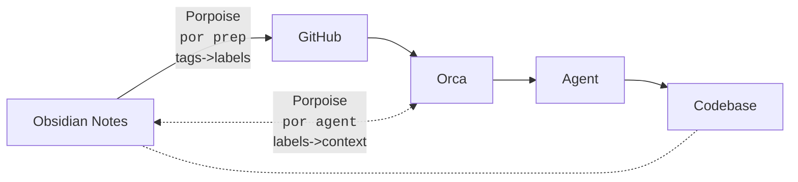

# Porpoise
(modded version of the Porpoise README.md)
### 🚀 Orca + Obsidian + GitHub labels = agents that really understand you! ✨

Porpoise is an opinionated task and context automation system connecting [Orca ADE](https://www.onorca.dev/), [Obsidian](https://obsidian.md/) and GitHub labels (and Projects, if you like).

Porpoise lets you **draft GitHub issues in Obsidian**, with Obsidian **tags becoming GitHub labels**, and when you later pick up the issue with Orca for implementation, it uses labels **to auto-compose your context prompt** from dedicated Obsidian notes. All within your codebase:



## Who Is This Good for?
The motivation behind Porpoise is to avoid having to repeat the same snippets of context information over and over manually in prompts. It adds an automation layer to your stack that is particularly useful for complex projects:

- **Easy tasks**: You prompt – your agent understands ("well enough" for the limited purpose).
- **Intermediate projects**: You provide an `AGENTS.md` (or multiple), tweak policies, direct your agent at interesting files/folders ... As long as your agent gets along, this may be all you need.
- **Highly complex and modular projects**: You need heavy control and test layers with strong guardrails to steer your agents into very specific directions, as every detour may soon exceed their context window. This adds extra complexity to your project/stack/setup which, as it grows, becomes your new bottleneck. *If* you manage to balance all of this right, your agents may still get along ... but *do you, too*?

The more complex things get, the faster you find yourself in a trade-off: Either you need to point things out explicitly which, as a human lead, may be obvious to you –composing context carefully, choosing the right set of guardrails for the task ... Fine, but this has *you* end up micromanaging or working on the AI framework rather than your project.

*OR* you give up control and let your agent decide autonomously (like with `AGENTS.md`). Sure, activate yolo mode and go ahead! But there are use-cases where delegating control to this degree is too risky, too review-intense, or just doesn't work out. For me it was the context window limits – even though it *sounds* large enough at first, with time and complexity, cases piled up where my agents lost track of their original task just due to the degree of complexity and customization involved at every other corner of the code base.

Porpoise provides your agents with the clear guidance they require, while giving *you* back the freedom to focus on your project and manage prompts and tasks on the level they belong:
- draft specs or task briefs using your project's lingo rather than generic tech terms
- prepare task briefs and reusable context prompts efficiently without ever leaving Obsidian
- compose context automatically from configurable tags and GitHub labels
- have Porpoise add *implicit* context, nowhere mentioned in your briefs, inferred from simple yet powerful implication rules
- turn single-line tasks into fully elaborated prompts – click Orca's Start ▶️ button to create a dedicated worktree and run them in interactive, parallel agent sessions 🪄✨
## Setup
### Step 1: Install the `por` CLI
Clone the repo and install it globally with `npm`:
```shell
git clone git@github.com:mastoryberlin/porpoise.git
cd porpoise
npm i
npm add -g .
```
#### Use `sudo` on Windows/WSL:
```shell
git clone git@github.com:mastoryberlin/porpoise.git
cd porpoise
npm i
npx tsc                              # produces dist/commands/por.js
chmod +x dist/commands/por.js
sudo npm i -g .                      # /usr prefix needs root
```

### Step 2: Prepare Your Project Repository
Porpoise assumes three things about your setup:
1) Your code is locally present as a *a bare git repository.
2) Your repo's *main branch* (`main`, `dev`, or whatever it's called in your case) is at the same time an Obsidian vault.
3) You are using GitHub and GitHub Projects to manage your issues, and have Orca connected with it as well.
Read on for details on each of the preconditions above.

#### Make your repo an Obsidian vault
Once you're done with the git setup, open Obsidian, click the vault selector to select Manage Vaults / Open Folder as Vault your project's *default branch* (!) in Obsidian to turn it into a vault. **Be sure NOT to open the repo's root folder itself** but **only** the default branch subfolder - e.g. open `main`, not `my-project`. (The [Vault Nickname Community Plugin](obsidian://show-plugin?id=vault-nickname) can help you avoid multiple vaults named `main` when dealing with multiple projects.) 

This creates a new `.obsidian` folder in your default branch to store your vault's local metadata. Consider adding a line `.obsidian` to your `.gitignore` file so it doesn't get committed together with the code!

#### Obtain a GitHub Personal Access Token (PAT)
... and assign it to some environment variable, e.g. add a line `export GITHUB_PAT=github_path_...` to your `~/.bashrc` or (`~/.bash_profile` on WSL), then configure `github.accessTokenEnvVar` to the name you gave that env variable (default: `GITHUB_PAT`) .

### Step 3: Initialize the Project for Porpoise
```shell
cd path/to/my-project/main # or whatever your default branch is called
por init
```
The CLI will walk you through a number of questions. 

Afterwards, take a look at the new `porpoise-config.json` file generated in the worktree root, and check out the available config options which should be adjusted to your connected repo and GitHub project and mostly self-explanatory (at least if your editor supports JSON schema auto-complete and showing hints based on schema fields' `description` property, like VSCode does).
### Step 4: Configure Orca
1. Open Orca's Settings / Agents panel, pick any installed agent you don't actually use, *overwrite* i.e. customize its command line to `por agent`, and make it your new default agent. – Now, whenever you start a new agent session (from an issue or otherwise), you're defaulting to channel it through Porpoise which you can configure to delegate to any "real" agent of your choice via the `orca.agentCommands.newSession` config option.
2. In your project settings (or the defaults), look for the worktree creation / worktree archive hooks and set them to `por orca worktree setup` and `por orca worktree teardown`, respectively. Similar to the agent config above, this will make Orca channel hook handling through Porpoise, which in turn can be configured to run any commands or scripts committed with your code via the `orca.worktreeHooks.setup` / `orca.worktreeHooks.teardown` options.
### Step 5: Get the [Obsidian Plugin](https://github.com/mastoryberlin/porpoise-obsidian) (optional)
There's a community plugin available which adds 2 features that make working on a Porpoise project with Obsidian ultra-convenient:
1. Auto-completion of repo paths (default branch) after typing `@`. Typing Enter, Tab or / selects an entry; Ctrl+Backspace removes the last segment from a path. – Very useful to reference files to coding agents anywhere in prompts.
2. An integrated task graph, based on a slightly adjusted version of the [Spatial Task Graph community plugin](obsidian://show-plugin?id=spatial-task-graph). – The graph permits you to sketch tasks, break them down, and visualize their mutual dependencies, before elaborating them in detail.

The Obsidian plugin is in great beta shape but hasn't yet been published to the community plugin registry, so you have to install it indirectly via [BRAT](obsidian://show-plugin?id=obsidian42-brat) by adding the plugin repo (`https://github.com/mastoryberlin/porpoise-obsidian`) to the list of beta plugins.
If everything worked, you'll see a new graph icon in the left sidebar. Click it to open the *task graph* - your entry hub to getting productive with Porpoise!

## How It Works
Here's a typical workflow as Porpoise encourages and supports it. 
Note how steps 1-3 are all possible without ever leaving Obsidian: Preparing your agent's context and specific task prompts is editing Markdown content, which is what Obsidian shines at - use speech-to-text, snippets, or any other plugins you want.
### 1) Prepare your GitHub labels
- create your labels on GitHub (`por label` subcommand coming soon!)
- call `por sync` to synchronize your local config schema with existing labels
- `por sync` also writes one *label stub* note per GitHub label into the `labels` folder (configurable via `folders.labelStubs`), named and tagged after the label's lowercase, kebab-cased form – e.g. label `deploy env` becomes `labels/deploy-env.md` containing the Obsidian tag `#deploy-env`, ready to be inlined in your prep titles (see below)
- review `porpoise-config.json` and potentially edit it:
	- adjust `labels.sort` to sort the order in which your label prompts are put together to compose the initial prompt passed to the agent session
	- create or modify label implication rules in `labels.imply`. A rule is a key-value map from "present label combos" to sets of "implied labels" where ...
		- a label is *present* if it was directly attached to the issue, or if it was itself implied from another rule;
		- a *label combo* is a comma-separated string of labels which is "present" if all individual labels are present;
		- *implied labels* are added to the set of currently present labels when the implication rule triggers;
		- and implication rules are applied recursively until no more labels are added by any rule (a finite loop because labels are accumulated set-wise from a finite list).
- optionally, call `por sync` again to visualize label implications in Obsidian's graph view.
### 2) Prepare your tasks in prep files
- one task = one `# Markdown H1 header`
- organize tasks freely into any number of prep files in a dedicated folder.

E.g. if your Porpoise prep folder is called `prep` (the default; configurable via the `folders.prepFiles` config option), add a Markdown file resp. Obsidian note `fresh-food` in that folder and add some content:
```markdown
# acquire a #green apple
# buy #green and #yellow bananas
# chew some cashews
```

Open the task graph view to see all your tasks inside the prep folder at once. Draw connections between them to indicate dependencies, drag them around or hit the layout button for a better overview.
### 3) Prepare context prompts
 - store reusable prompts in a dedicated `prompts` folder (configurable via the `folders.prompts` config option)
 - organize the `labels` subfolder of `prompts` into subfolders, *one per GitHub label* that signifies relevance of the context prompts that live there, each named after the label's lowercase, kebab-cased form (e.g. label `deploy env` -> `deploy-env`). E.g. if you have three GitHub labels "green", "yellow" and "color", you might store your prompts as files (resp. Obsidian notes) like this:
```
prompts
	labels
		color
			01.file.md
			02.another-file.md
		green
			green-prompt.md
		yellow
			my-prompt-for-yellow.md
```
### 4) Elaborate tasks
Tasks are headers for a reason: add details in the "body" below them (may include H2, H3... subheaders), then collapse the entire section to focus on something else.
Again, you can view or even edit task bodies (though less conveniently) from the graph view as well!
### 5) Turn tasks into GitHub issues
Whenever you're done preparing some task, append an exclamation mark to its title - `# acquire a #green apple` becomes `# acquire a #green apple!`, visually indicating their being ready for implementation. Run `por prep` to bulk-create GitHub issues for all tasks marked as ready like this; you'll also observe that the corresponding task sections move below a separator line within their respective prep file. Once you trust Porpoise enough, you can opt to have `por watch` run in your default worktree continuously so issues get created and moved as you add exclamation marks.

Every issue that Porpoise creates on GitHub automatically gets assigned:
- the GitHub project configured in the `github.project.number` config option (automatically set by `por init`)
- the project *status* configured in `preparedIssues.initialStatus` (assuming that `por init` was able to detect your project's status field correctly)
- all assignees configured in `preparedIssues.assignees`
- any GitHub labels that match tags in the task header / title after normalizing both – e.g. if the repo had a label "green" defined, in the above apple example Porpoise will auto-assign that label to the issue being created

**Note 1**: Tags and GitHub labels are matched after *normalization*: both are mapped to a lowercase, kebab-cased form in which any sequence of non-word characters (spaces, punctuation, ...) collapses into a single hyphen, and a redundant word "layer" is dropped. E.g. tag `#deploy-env` matches the GitHub label `deploy env`, tag `#label-policy` matches `Label Policy`, and label `editor layer` normalizes to `editor`. The same normalized form is consistently used for label stub file names and tags (`labels/deploy-env.md` -> `#deploy-env`) as well as per-label prompt folders (`prompts/labels/deploy-env/`).
**Note 2**: GitHub labels *implied* by the ones appearing in task titles (see below) are *not* auto-assigned on issue creation; instead, they are implicitly added to the picture when `por agent` picks up the issue as part of the typical Orca workflow.

### 6) Review, finalize, and pick up issues in Orca
Use Orca's embedded Tasks module to review, tweak, and prioritize issues created for you by Porpoise – or use the original GitHub Issues, Project, and Labels pages, which (pro tip) you can always keep opened and available at a keyboard shortcut in Orca's floating workspace.
Once you're done, "Start" ready issues from the Tasks module (Issues or Project view). If your setup is right, this will cause Orca to create a new worktree and run `por agent` inside it, which will receive the issue details, put together the prompt from label context, and pass it on to your configured agent.
From here on, it's all standard Orca / agent interactions; just keep in mind that *any* prompt you enter in a conversation – including follow-ups – might be worth extracting it into its own context prompt!